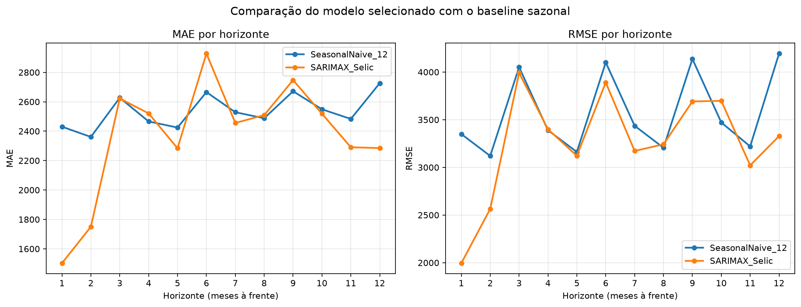
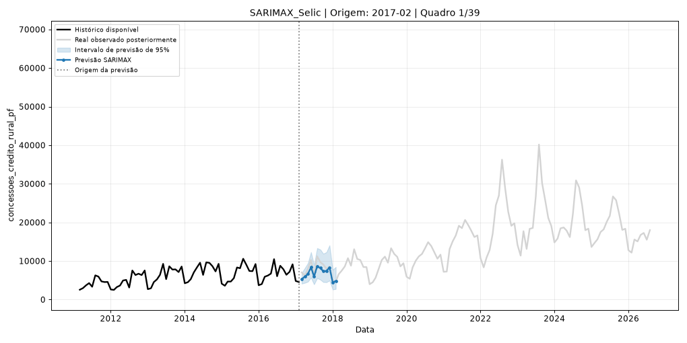

# Previsão de Concessões de Crédito Rural para Pessoas Físicas

Projeto de análise e previsão de séries temporais das concessões mensais de crédito rural para pessoas físicas no Brasil, utilizando dados do Banco Central do Brasil (BCB).

## Objetivo

Investigar padrões de tendência e sazonalidade e avaliar modelos estatísticos e de Machine Learning para prever o volume mensal de concessões de crédito rural.

## Dados

- **Fonte:** Banco Central do Brasil (BCB).
- **Variável-alvo:** `concessoes_credito_rural_pf` — série 20701, em milhões de reais.
- **Período:** março de 2011 a agosto de 2026.
- **Observações:** 186.
- **Variáveis exógenas candidatas:** Selic, IPCA, índice de atividade econômica e dólar.

A coleta e a organização dos dados fazem parte do projeto [Arquitetura de Dados — Sistema de Gestão de Crédito](https://github.com/FernandoLKS/Arquitetura-de-Dados-SGC-Banco-Central).

## Metodologia

1. Análise exploratória da série temporal.
2. Avaliação de estacionariedade e identificação de tendência e sazonalidade.
3. Treinamento e comparação de modelos estatísticos e de Machine Learning.
4. Backtesting temporal para seleção do modelo.
5. Avaliação final em um período de teste de 12 meses, não utilizado na seleção.
6. Análise dos erros e dos resíduos do modelo selecionado.

O conjunto de desenvolvimento compreende março de 2011 a agosto de 2025. O teste final compreende setembro de 2025 a agosto de 2026.

## Resultados

O modelo selecionado foi o **SARIMAX com Selic como variável exógena**, com especificação SARIMAX(1,1,1) × (1,0,1,12).

### Comparação no conjunto de desenvolvimento

| Modelo | MAE (R$ milhões) | RMSE (R$ milhões) | Weighted RMSE (R$ milhões) |
|---|---:|---:|---:|
| SARIMAX com Selic | 2.393,31 | 3.357,80 | 3.343,96 |
| SARIMAX com Selic e IPCA | 2.433,69 | 3.414,97 | 3.400,39 |
| SARIMAX com Selic e atividade econômica | 2.463,91 | 3.428,12 | 3.410,22 |
| SARIMAX com IPCA | 2.439,43 | 3.524,50 | 3.485,75 |
| SARIMAX com variáveis macroeconômicas | 2.493,56 | 3.504,61 | 3.486,83 |
| SARIMA(1,1,1) × (1,0,1,12) | 2.438,74 | 3.575,63 | 3.537,12 |
| Naive sazonal (12 meses) | 2.531,78 | 3.592,85 | 3.582,61 |
| SARIMAX com atividade econômica | 2.705,92 | 3.722,58 | 3.688,55 |

A seleção foi realizada com base no Weighted RMSE no conjunto de desenvolvimento, sem utilizar o teste final para escolher o modelo.

## Comparação entre modelos

### Avaliação no teste final

| Métrica | Resultado |
|---|---:|
| Horizonte | 12 meses |
| MAE | R$ 2,04 bilhões |
| RMSE | R$ 3,08 bilhões |
| Weighted RMSE | R$ 2,88 bilhões |

O modelo apresentou resultados razoáveis em parte do período de teste, mas superestimou as concessões nos meses finais, especialmente em julho e agosto de 2026.

### Diagnóstico dos resíduos

Os testes de Ljung-Box indicaram autocorrelação residual nos lags 12 (*p* = 0,0085) e 24 (*p* = 0,0093). O teste ARCH não indicou evidência de heterocedasticidade condicional (*p* = 0,8461), enquanto o teste de Jarque-Bera apontou desvio da normalidade (*p* = 0,0106).

Esses diagnósticos foram obtidos em um ajuste sobre a série completa e, portanto, devem ser interpretados com essa limitação em mente.

## Limitações

- O desempenho depende da dinâmica da série e pode se deteriorar diante de mudanças no cenário econômico.
- A inclusão de variáveis exógenas exige hipóteses sobre seus valores futuros.
- Para projeções futuras, a Selic é mantida constante no último valor observado, representando um cenário de referência, e não uma previsão independente da taxa.
- A autocorrelação residual sugere que ainda há estrutura temporal não capturada pelo modelo.

## Evolução das previsões de 12 meses

## Tecnologias

Python, Pandas, NumPy, Matplotlib, Statsmodels, Scikit-learn e XGBoost.

## Conclusão

O SARIMAX com Selic apresentou o menor Weighted RMSE no conjunto de desenvolvimento entre os modelos avaliados. Entretanto, os erros no final do teste e a autocorrelação residual indicam oportunidades de melhoria, como testar outras especificações sazonais, aprimorar a seleção de variáveis exógenas e avaliar modelos alternativos.

O projeto demonstra um fluxo de trabalho de análise e previsão temporal aplicado a dados macroeconômicos e de crédito, com separação temporal entre seleção e avaliação final do modelo.